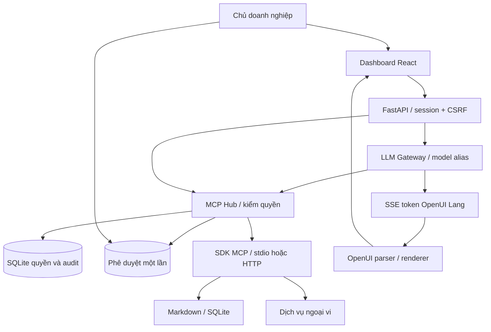

# BDSG Solo-OS v0.1

## Phạm vi và nguồn tham khảo

Yêu cầu trực tiếp chọn FastAPI, MCP hard enforcement và OpenUI Lang. Đặc tả đính
kèm mô tả cây thư mục và hướng đi dài hạn. Kho local `soloceo` được tham khảo;
các yêu cầu monorepo NestJS/Supabase đa tenant của tài liệu kho đó không đổi stack
của dự án mới này. Không sửa kho SoloCEO hay chạy script deploy trong kho tham khảo.

Đã đối chiếu mã: `apps/web-platform/src/shell/apps/registry.tsx`, `overview.tsx`,
`settings-app.tsx`, `apps/api-core/src/approvals/approvals.service.ts`,
`rules/rules.service.ts`, `mcp-servers/dolphin-docs/server.py`.
Kế thừa ý tưởng điều hướng theo app, phê duyệt của chủ và gateway LLM;
viết lại code cho hệ thống một người, không sao chép dữ liệu hoặc secrets.

## Đường thực thi

## Ranh giới tin cậy

- API xác thực principal từ cookie ký hoặc bearer credential. Actor không nhận
  từ JSON request. LLM luôn gọi Hub dưới actor `agent`, kể cả trong chat của chủ.
- Chỉ endpoint chủ có quyền sửa connector hoặc quyết định phê duyệt. Agent
  credential chỉ có discovery và gọi công cụ qua Hub.
- Hub kiểm allowlist trước khi mở transport, validate tham số với schema mới,
  rồi kiểm lại revision trước dispatch. Không dùng annotations để cấp quyền.
- Xác nhận chứa snapshot JSON của tham số, revision và hash định nghĩa tool.
  SQLite `BEGIN IMMEDIATE` claim trước dispatch để tránh gọi trùng giữa workers.
  Khi lỗi mơ hồ, approval đã consume và không được tái sử dụng.
- Credential được mã hóa Fernet; audit chỉ ghi action/connector/tool/actor,
  không ghi khóa, tham số hay kết quả. Approval chứa tham số để chủ kiểm tra,
  nên database và bản backup vẫn phải được bảo vệ như dữ liệu doanh nghiệp.
- Chương trình MCP cài đặt là thành phần được tin cậy. Hub không bảo đảm một
  công cụ được chủ đánh dấu read-only thật sự không ghi; cần kiểm tra implementation
  và dùng credentials chỉ đọc tại chính dịch vụ ngoài.
- OpenUI render thư viện đã đăng ký, không `eval`, không raw HTML. Không cung
  cấp toolProvider trực tiếp trong browser; form chỉ phát user intent. Mọi tool
  do LLM gọi đều về Hub backend và không nhận quyền duyệt từ form sinh ra.
- Session hết hạn 12 giờ. SQLite chỉ lưu hash token để kiểm tra còn hiệu lực;
  đăng xuất thu hồi session trong database và xóa cookie, nên cookie cũ không
  dùng lại được. Khi nghi bị lộ khóa chủ, đổi OWNER_TOKEN và xóa các bản ghi
  bảng `sessions` trong `system/mcp.db` để đăng xuất mọi thiết bị. Không tùy tiện
  đổi STORE_KEY trên volume đã có: cần giải mã/re-encrypt credentials khi rotate.

## Chọn SDK và frontend

[MCP SDK v1](https://github.com/modelcontextprotocol/python-sdk/tree/v1.x) được
pin `<2` và khóa trong `uv.lock`; không tự nâng major. Transport scopes được mở
và đóng trong cùng task để tuân thủ vòng đời AnyIO. Bản đầu mở session theo thao
tác, thuận tiện cho cô lập và cleanup; chưa có pool phiên dài hạn.

[OpenUI React Lang](https://www.openui.com/docs/openui-lang/renderer) phiên bản
0.4.1 cung cấp parser/renderer theo luồng. Thư viện nhỏ được khai báo bằng Zod,
prompt sinh từ chính thư viện đó. Frontend tích lũy token có giới hạn và cập nhật
theo animation frame, giải mã UTF-8 incremental, đọc SSE bất kể ranh giới chunk,
hủy fetch khi unmount, kiểm tín hiệu done và báo lỗi. Vite chỉ dùng cho bundle
nhẹ khi build; runtime là static assets được FastAPI phục vụ.

## Giai đoạn tiếp theo

Background worker thực thi việc, sandbox sub-agent, nhắc lịch và connector
Telegram/Zalo cần được xây thêm. Tự học cần pipeline trích xuất, duyệt tri thức
và undo bằng Git. Bản v0.1 không giả lập các chức năng này thành tính năng đã chạy.
